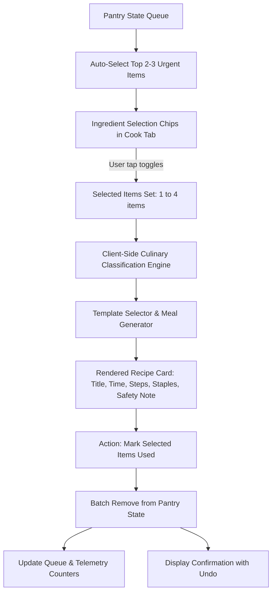

# Dynamic Recipe Matching Engine — Design Specification

**Date:** 2026-09-28  
**Project:** UseFirst Mobile Pantry Coach (`d:/usefirst/05_UseFirst_Product_Prototype.html`)  
**Status:** Approved  

---

## 1. Overview & Goals
The UseFirst prototype currently features a single static recipe ("Creamy spinach pasta") locked to spinach. This specification expands the "Cook now" screen into a **Dynamic Recipe Matching Engine** that:
- Intelligently pairs any 2 to 4 perishable items currently in the user's priority queue.
- Automatically selects the top 2–3 closest-to-expire items while providing tap-to-select chips for user customization.
- Generates realistic, practical, sub-20-minute meal instructions using universal pantry staples (oil, salt, pepper, water).
- Adheres 100% to the AI Agent constraints and JSON schema defined in `AGENT.md`.
- Provides batch completion ("Mark [N] items used") with undo and confirmation feedback.
- Operates 100% client-side with zero external network APIs or library dependencies.

---

## 2. Architecture & Data Flow



---

## 3. Component Specifications

### 3.1. Culinary Classification Matrix
A lightweight, in-memory classification dictionary maps pantry items (both sample defaults and common user inputs) into culinary roles:

```javascript
const CULINARY_ROLES = {
  // Leafy & Tender Vegetables
  spinach: 'greens', kale: 'greens', lettuce: 'greens', arugula: 'greens', herbs: 'greens', cabbage: 'greens',
  // Hard Vegetables & Aromatics
  onion: 'aromatic', garlic: 'aromatic', carrot: 'veg', broccoli: 'veg', pepper: 'veg', bell_pepper: 'veg',
  mushroom: 'veg', zucchini: 'veg', tomato: 'veg', cucumber: 'veg',
  // Dairy & Creamy Elements
  milk: 'dairy', yogurt: 'dairy', 'greek yogurt': 'dairy', cream: 'dairy', cheese: 'dairy', butter: 'dairy',
  // Starches & Grains
  pasta: 'starch', rice: 'starch', bread: 'starch', potato: 'starch', noodles: 'starch', oats: 'starch',
  // Proteins
  eggs: 'protein', egg: 'protein', tofu: 'protein', chicken: 'protein', beef: 'protein', beans: 'protein', fish: 'protein',
  // Fruits
  berries: 'fruit', apple: 'fruit', banana: 'fruit', avocado: 'rich_fruit', lemon: 'fruit'
};
```

If an item is unrecognized, it defaults to `'veg'` (or `'pantry_item'`) to ensure universal matching without errors.

### 3.2. Recipe Templates (Strict `AGENT.md` Compliance)
Templates evaluate the active roles in the selected set:

| Priority | Role Combination | Recipe Generated | Est. Prep Time |
| :--- | :--- | :--- | :--- |
| **1** | `greens` + `dairy` + `starch` | **Creamy Greens Pasta / Skillet** | 15 mins |
| **2** | `protein` + any `veg`/`greens` | **Quick Pantry Scramble or Frittata** | 12 mins |
| **3** | `starch` + any `veg`/`protein` | **Savory Pantry Fried Rice / Grain Bowl** | 14 mins |
| **4** | `dairy` + `fruit` or `grain` | **Fresh Pantry Parfait / Warm Oats** | 8 mins |
| **5** | any 2+ `veg`/`greens` | **Rustic Garlic-Herb Vegetable Sauté** | 10 mins |
| **Fallback** | Any 1–4 items | **Chef's Quick Pantry Medley** | 15 mins |

Each recipe output object provides:
```json
{
  "recipe_title": "string",
  "prep_time_minutes": 15,
  "matched_items": ["item1", "item2"],
  "pantry_staples_assumed": ["cooking oil", "salt", "black pepper", "water"],
  "instructions": [
    "Step 1...",
    "Step 2...",
    "Step 3..."
  ],
  "safety_reminder": "Check ingredient appearance and aroma before preparation. Follow package guidelines."
}
```

### 3.3. Cook Tab UI & Interaction Details
1. **Header & Context:**
   - Title: `Cook now`
   - Subhead: `Dynamic meal ideas from your perishables`
2. **Interactive Ingredient Selector Chips:**
   - Pill chips for each item in the pantry.
   - Selected chips have Forest Green background (`#1F4D3A`) and checkmark icon.
   - Unselected chips have border styling (`rgba(25, 48, 41, 0.15)`).
   - Selecting/unselecting triggers instant live recipe re-generation.
   - Clear helper text: *"Select 1 to 4 items from your pantry to pair."*
3. **Recipe Presentation Card:**
   - Lime accent container (`var(--color-lime-bg)`, border `rgba(184, 217, 108, 0.6)`).
   - Overline tag: `COOK FIRST · <X> MINS`.
   - Title: Bold serif heading (`20px`).
   - Matched ingredient pill list.
   - Numbered step list with clean spacing.
   - Assumed staples note: *"Assumes universal kitchen staples: cooking oil, salt, black pepper, and water."*
   - Safety banner: *"Check ingredient appearance and aroma before preparation. Follow package guidelines."*
4. **Batch Action & Undo Feedback:**
   - Primary CTA button: `Mark [X] items used` (Orange `#F28C45`).
   - Clicking immediately clears all matched items from the pantry state and recalculates telemetry.
   - Renders inline banner: `"[Items] marked used. [Undo]"` with 5-second auto-dismiss.

---

## 4. Error Handling & Edge Cases
- **Empty Pantry:** Display informative empty state card prompting user to tap `Add food` to begin.
- **No Items Selected:** Display prompt: *"Tap at least one ingredient chip above to generate a meal idea."*
- **Single Item Selected:** Generates a standalone preparation (e.g., Simple Steamed/Sautéed Spinach, Quick Poached Egg, Toast).
- **Custom / Novel Ingredient:** Fallback classification ensures custom inputs (e.g., "Artichoke", "Halloumi") always produce coherent instructions without runtime exceptions.

---

## 5. Verification Plan
- **Unit / Logic Checks:**
  - Verify role classification for default items (Spinach -> greens, Milk -> dairy, Yogurt -> dairy, Pasta -> starch).
  - Verify recipe generator output keys match `AGENT.md` schema verbatim.
  - Verify prep time is always $\le 20$ minutes.
- **Browser Interaction Checks:**
  - Default load: Top urgent items (Spinach, Milk) auto-selected, valid recipe displayed.
  - Chip toggle: Tapping "Greek Yogurt" recomputes recipe dynamically.
  - Batch used: Clicking "Mark 2 items used" removes both items from queue and decrements telemetry.
  - Undo: Clicking "Undo" restores previously cleared items.
  - Persistent disclaimer remains verbatim in footer.
